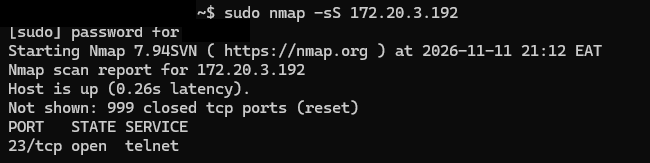
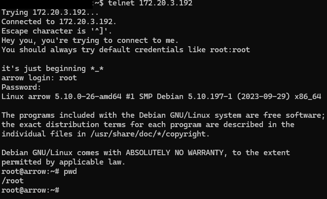

# Arrow | Hackviser

**Category:** Telnet
**Difficulty:** Basic

## Goal
Learning the basics of Telnet

## Steps
1. I utilized nmap in order to find out information about ports and services running on the target machine
    ```
    sudo nmap 172.20.3.192
    ```



2. I then connected to the target machine via the command. I then provided the credentials root:root to gain access to the machine:
    ```
    telnet 172.20.3.192
    ```



## The Vulnerability
Use of Telnet, which is an unencrypted protocol.
Very weak login credentials to the target machine.

## How to fix it
Using more secure protocols for secure remote connection, for example SSH.
Changing the weak default password to one that is long, unique and that is not easily guessable.

## What I Learned
Before attacking anything, I scan to see what the machine exposes. One nmap scan showed a single open port, 23 (telnet), and that one service was enough to take over the machine. Telnet does not encrypt traffic, and the root account still had its default password, so I got a root shell on the first guess. As a defender, I would disable telnet, use SSH instead, and change every default password.
