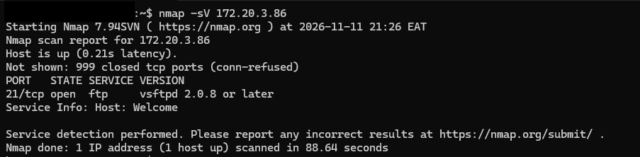
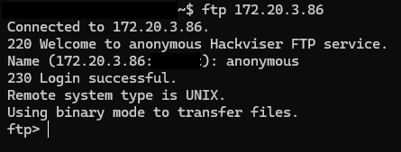
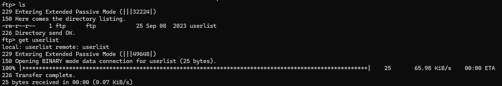
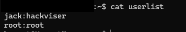

# FileHunter | Hackviser

**Category:** FTP
**Difficulty:** Basic

## Goal
Practice identifying an FTP service and retrieving a file through anonymous access.

## Steps
1. I scanned the target with service detection to identify the service and its version.
    ```
    nmap -sV 172.20.3.86
    ```



2. I connected to the FTP server and tried its anonymous login.
    ```
    ftp 172.20.3.86
    ```



3. I listed the remote files and downloaded the user list.
    ```
    ls
    get userlist
    ```



4. I read the downloaded file locally.
    ```
    cat userlist
    ```



## The Vulnerability
The FTP server allowed anonymous access to a file that should not have been public.
FTP does not encrypt data in transit.

## How to fix it
Disable anonymous access or limit it to approved public files.
Use SFTP or FTPS for file transfers and restrict access to the server.

## What I Learned
I scanned the target with service detection and found FTP. I connected anonymously, listed the available file, and downloaded it for local review. The weakness was public access to a file over an unencrypted protocol. As a defender, I would restrict FTP access and use SFTP or FTPS for transfers.
