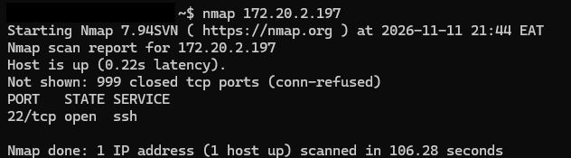
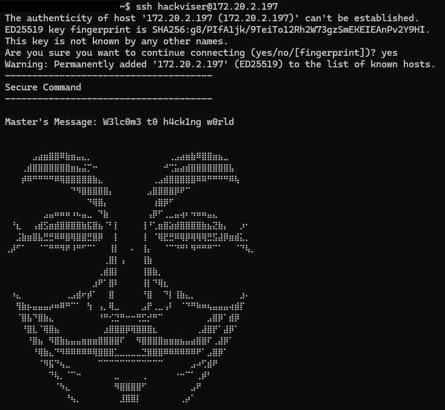
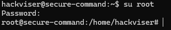
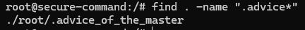
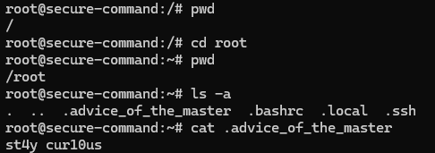

# SSH | Hackviser

**Category:** SSH
**Difficulty:** Basic

## Goal
Practice connecting to an SSH service, switching users, and locating a hidden file.

## Steps
1. I scanned the target to see which service was available.
    ```
    nmap 172.20.2.197
    ```



2. I connected to the SSH service using the challenge account.
    ```
    ssh hackviser@172.20.2.197
    ```



3. I checked whether I could switch to the root user.
    ```
    su root
    ```



4. I searched for the hidden advice file from the current directory.
    ```
    find . -name ".advice*"
    ```



5. I checked root's home directory and read the hidden file.
    ```
    pwd
    cd root
    pwd
    ls -a
    cat .advice_of_the_master
    ```



## The Vulnerability
The root account used a weak credential that allowed privilege escalation.

## How to fix it
Use strong, unique credentials and restrict which accounts can gain root access.
Limit SSH access to authorized users and use key-based authentication where possible.

## What I Learned
I scanned the target and found SSH exposed. After connecting with the challenge account, I found that the root account could be reached with a weak credential. I located a hidden file in root's home directory. As a defender, I would restrict privilege escalation, use strong authentication, and limit who can reach SSH.
